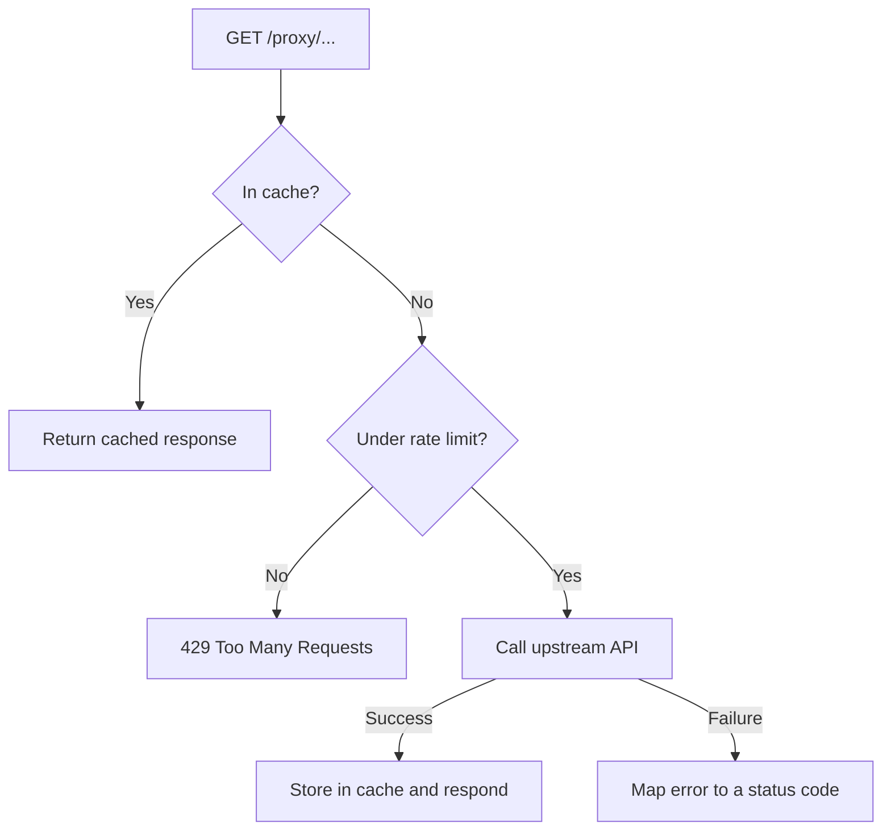

# Caching Proxy and Rate Limiter

An Express and TypeScript server that sits in front of a public API, caches successful responses for a fixed time, and limits how many requests can trigger a real upstream call. It forwards `GET` requests to [JSONPlaceholder](https://jsonplaceholder.typicode.com).

## Features

- Forwards any `GET /proxy/<path>` to the upstream API, query strings included
- In-memory cache with a 60-second time-to-live, logged as `Hit` or `Miss`
- `Cache-Control` header on every successful response, tied to the same TTL value
- Rate limiting that counts only cache misses (10 per minute per client), so cheap cache hits are never throttled
- Upstream failures mapped to accurate status codes instead of a blanket 500

## Tech stack

Node.js, Express 5, TypeScript, axios, node-cache, express-rate-limit

## Getting started

Requires Node.js 18 or newer. No environment variables are needed.

```bash
git clone https://github.com/YOUR-USERNAME/caching-proxy-rate-limiter.git
cd caching-proxy-rate-limiter
npm install
npm run dev
```

The server runs at `http://localhost:3000`.

| Script | What it does |
|---|---|
| `npm run dev` | Run with ts-node |
| `npm run build` | Compile to `dist/` |
| `npm start` | Run the compiled build |

## Usage

```bash
curl -i http://localhost:3000/proxy/posts/1
```

- First request: the terminal logs `Miss`, the upstream API is called, and the response carries `Cache-Control: public, max-age=60`.
- Repeat within 60 seconds: the terminal logs `Hit` and no upstream call is made.
- More than 10 cache misses in a minute: the server answers `429` with `{ "status": 429, "error": "Too many requests, please try again" }`.

## How it works



## Design decisions and edge cases

- **The cache key is the full original URL**, so `/proxy/comments?postId=1` and `/proxy/comments?postId=2` are cached separately.
- **Failed requests are never cached.** The cache is written only after the upstream call succeeds.
- **The rate limiter runs inside the cache-miss branch** instead of as global middleware. Only requests that cost a real network call count against the limit.
- **`max-age` and the cache TTL share one constant**, so the header and the cache cannot drift apart.
- **Upstream errors are not flattened into one 500:**

| Situation | Response |
|---|---|
| Upstream replied with an error status | The same status and body are relayed |
| Upstream unreachable or no response | `504 Gateway timeout` |
| The request could not be built | `500` with the error message |
| Any other error | `500` |

## Testing

Tested manually in Postman: hit and miss behaviour, expiry after the TTL (using a short TTL while testing), more than 10 distinct requests in a minute for the `429`, an upstream 404 (`/proxy/posts/99999`), and a deliberately broken base URL for the `504`.

<!-- Export your Postman collection to docs/postman_collection.json and link it here. -->

## Limitations and next steps

- The cache and rate-limit counters live in memory. They reset on restart and are not shared between instances. Redis would fix both.
- `Cache-Control: max-age` always reports the full TTL, even for an entry that has already aged.
- Only `GET` requests are proxied, and the upstream base URL is hardcoded.
- No automated tests yet.

## License

MIT
